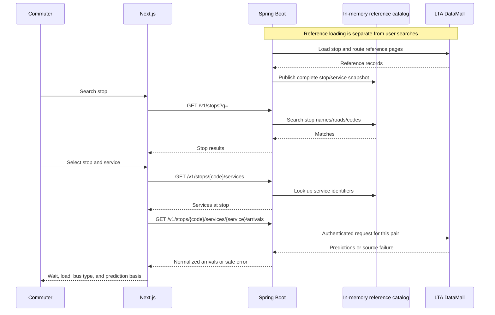

# Proposed LTA integration flow

Status: **proposal for owner review; not implemented**. Companion:
[endpoint contract](api-contract.md). This increment implements live information
only. It does not implement the historical collector or domain database schema.

## Data flow



The browser-facing URLs include `/api` before the `/v1` paths shown above;
Next.js's existing rewrite removes that prefix. The service-list call occurs
after selecting the stop; the arrival call occurs after selecting a service.

## Upstream interfaces: verified facts

Base: `https://datamall2.mytransport.sg/ltaodataservice`.

| Need | LTA path / parameters |
| --- | --- |
| Stop reference records | `/BusStops` |
| Stop/service associations | `/BusRoutes` |
| Live predictions | `/v3/BusArrival?BusStopCode={code}&ServiceNo={service}` |

Send the `AccountKey` header server-side and request JSON. Reference collections
use pages of up to 500 records with `$skip`. The documented arrival update interval
is 20 seconds. Upstream slots are `NextBus`, `NextBus2`, `NextBus3`; useful fields
include `EstimatedArrival`, `Load`, `Type`, and `Monitored`.

LTA documents `SEA`/`SDA`/`LSD` load codes and `SD`/`DD`/`BD` vehicle codes.
`Monitored` distinguishes location-based predictions (1) from schedule-based ones
(0). Missing predictions alone cannot establish whether a service is operating.

Source: LTA [API User Guide v6.10, 1 Oct 2026](https://datamall.lta.gov.sg/content/dam/datamall/datasets/LTA_DataMall_API_User_Guide.pdf),
sections 1 and 2.1–2.4, checked 17 Oct 2026. The sections below are BusPulse proposals.

## Proposed reference-data strategy

Stop search needs a local index; service selection needs stop/service membership
even when current arrivals are absent. Start with a small in-process catalog,
avoiding a new database schema before it is designed.

1. When integration is configured, load both reference collections sequentially
   in a startup background task. This is finite catalog loading, not background
   arrival polling. Do not start it when the key is absent.
2. Retrieve every page, advancing by the returned page size until a short/empty
   final page. Bound page count, request duration, and overall load duration so a
   bad source cannot loop indefinitely. Discard a failed/partial load.
3. Build stop search entries and a stop-code-to-service-set index. Publish them
   together only after the whole load validates. Deduplicate repeated memberships;
   do not publish a temporarily partial catalog.
4. Until ready, catalog-dependent requests return `503 CATALOG_NOT_READY`.
   Health stays available; generic application health must not imply the catalog
   is ready. If loading fails, report a sanitized reason and require a deliberate
   application restart to retry in this initial version.
5. Retain the snapshot for this process's lifetime. A restart reloads it. Expose
   its receipt timestamp in reference responses; document that reference changes
   are not picked up until restart. Persistent catalogs, refresh schedules, and
   an administrative reload endpoint are deferred.

Downloading network-wide reference records does not collect network-wide bus
arrival history. Live arrivals are requested only for the selected pair; the
later collector still monitors only explicitly configured targets. No other
infrastructure or user accounts are needed for this strategy.

Tradeoff: startup makes multiple LTA requests and reference functionality cannot
survive a cold start during an upstream outage. Confirm actual page counts and
account limits before choosing final load bounds. Do not invent a universal
quota; use the account's current terms/observed responses. If restart traffic or
availability proves problematic, propose a persisted snapshot as a separate,
reviewed schema change.

## Proposed live-request handling

- A validated request triggers one call for its selected stop/service. Initially
  there is no live cache, automatic retry loop, request fan-out, or collector.
- Proposed client bounds: 2-second connection timeout and 5-second total arrival
  response deadline. These are tunable implementation choices, not LTA promises.
  Reference loading has a separate overall bound because it spans multiple pages.
- Validate source identity and distinguish recognized no-prediction responses
  from malformed data. Apply the contract's ETA/enumeration rules. Unknown load
  or type never becomes invented certainty.
- Return controlled errors for timeouts, authentication/configuration failures,
  throttling, and invalid payloads. Never claim an upstream outage means the
  commuter's stop does not exist. Add bounded backoff only if later justified;
  the initial implementation must not retry rejected credentials repeatedly.
- Read a source response before transforming it; fixtures preserve representative
  source shapes. This phase does not add observation storage. The historical
  collection issue will persist the raw source response before normalization,
  with explicit schema and uncertainty design.

## API key: where it will go

Once issued, store the key only in `apps/api/.env.local`:

```properties
LTA_ACCOUNT_KEY=replace-with-your-key-locally
```

This is a **proposed configuration name**. The current bootstrap does not read or
use it yet; implementation will add the Spring binding and an empty placeholder
to `.env.example`. Keep existing database settings in that file. Never replace
the whole file with this snippet, commit the real value, use a `NEXT_PUBLIC_`
variable, paste it into chat, or place it in a command-line URL. No real LTA calls
or credential reads were made to write this proposal.

## Proposed implementation boundaries

| Area | Responsibility |
| --- | --- |
| `integration/lta` | HTTP configuration, authenticated calls, source DTOs, response validation. |
| `stops` | Reference loading/index, stop search, services at a stop. |
| `arrivals` | Live use case, API DTOs, prediction transformation, error mapping. |
| Frontend, later issue | Search interaction, service selection, display and refresh. |

Before implementation, approve the contract and catalog strategy. The key permits
manual live verification later; it is not needed for proposal review or automated
fixture-based tests. Do not implement the collector, analytics, or frontend search
as part of this backend issue.
